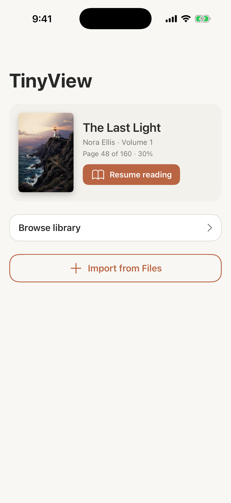
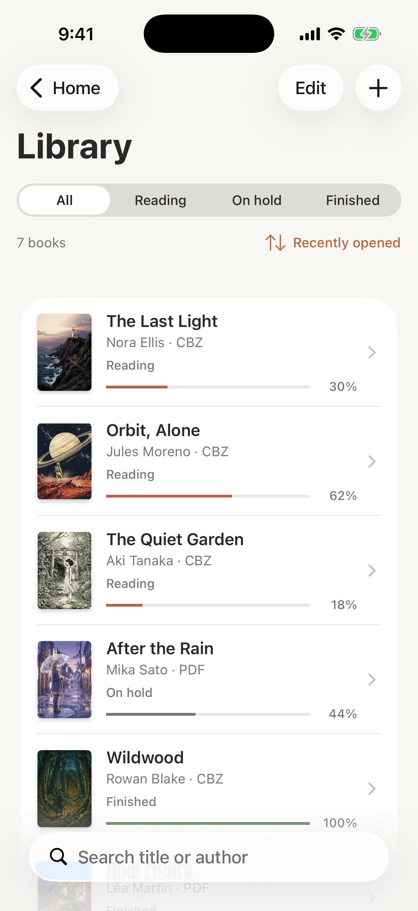
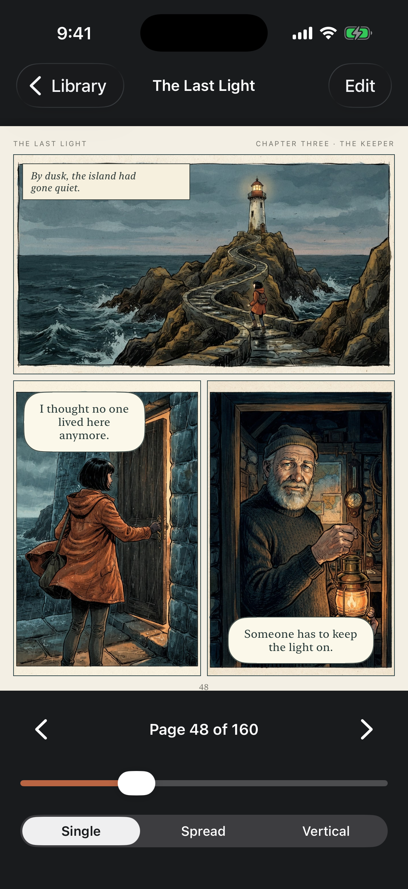
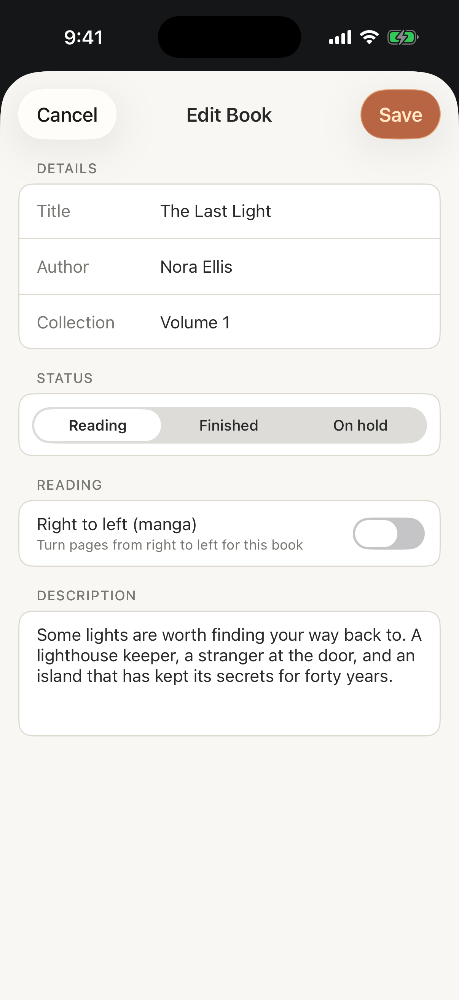

# TinyView

CPSC 411 iOS Mobile Application Development, Final Project, Milestone 1 (UIKit user interface)

The Xcode project is `comicreader.xcodeproj` at the root of the repo, with the source files in `comicreader/` (target and module name `comicreader`). The app shows up on the home screen as **TinyView**.

## Application name

**TinyView**

## Project description

TinyView is an offline comic, manga and PDF reader for iPhone. People who collect digital comics usually end up with CBZ and PDF files scattered across their phone, and most readers only open one format or forget where you stopped reading. TinyView keeps every book in one library, shows how far along you are in each one, tracks whether a book is in progress, on hold or finished, and supports right to left page turning for manga. It is built for students and anyone else who reads comics or manga on their phone and wants a simple, private library that works without an internet connection. For Milestone 1 the app uses hard coded sample books and the cover and page artwork from our Figma design; importing real files and rendering CBZ and PDF pages come in Milestone 3.

## Screen list

| # | View controller | Screen | Purpose |
| --- | --- | --- | --- |
| 1 | `home_view_controller` | Home | Entry point and root of the navigation stack. Shows a Continue Reading card for the current book with a Resume reading button, a Browse library button, and an Import from Files button. |
| 2 | `library_view_controller` | Library (list) | A `UITableView` of every book using a custom cell (cover, title, author, format, status, progress). Has a search bar, a segmented control that filters by status, a sort menu, an Edit button for deleting books, and a + button for adding a book. |
| 3 | `reader_view_controller` | Reader (detail) | Shows the selected book: its current page, a page counter, a slider to jump to a page, and a segmented control for Single, Spread or Vertical reading mode. Tap the page to show or hide the controls. An Edit button opens the book in the Edit Book screen. |
| 4 | `edit_book_view_controller` | Add / Edit Book | A form for adding a new book or editing an existing one: text fields for title, author and collection, a status segmented control, a right to left (manga) switch and a description text view, with Cancel and Save in the navigation bar. |

## Screen navigation diagram

```
                         ┌──────────────┐
                         │     Home     │
                         └──────────────┘
                           │     │     │
          Browse library ┌─┘     │     └─┐ Import from Files
                         │       │       │
                         ▼       │       ▼
               ┌──────────────┐  │  ┌──────────────────┐
               │   Library    │  │  │ Add Book (sheet) │
               └──────────────┘  │  └──────────────────┘
                 │          │    │ Resume reading
               + │  tap a   │    │
                 │  book    ▼    ▼
                 │     ┌──────────────┐
                 │     │    Reader    │
                 │     └──────────────┘
                 ▼             │ Edit
   ┌──────────────────┐        ▼
   │ Add Book (sheet) │  ┌───────────────────┐
   └──────────────────┘  │ Edit Book (sheet) │
                         └───────────────────┘
```

Home, Library and Reader are pushed on a `UINavigationController`, so the back button always returns to the previous screen. Add Book and Edit Book are presented as sheets with their own navigation bar holding Cancel and Save.

## Screenshots

| Home | Library | Reader | Edit Book |
| --- | --- | --- | --- |
|  |  |  |  |

## UIKit concepts used

| Requirement | Where it is used |
| --- | --- |
| UIViewController | Every screen is its own view controller, built in code (Option B, programmatic UIKit) |
| View hierarchy | Each screen builds its views in `build_layout()`: scroll views, stack views, cards and controls |
| Auto Layout | Anchors and `NSLayoutConstraint` on every screen, pinned to the safe area and layout margins, no fixed frames |
| UIStackView | Home content and Continue Reading card, library header, table cell layout, reader controls, every Edit Book form section |
| UITableView | Library screen with `UITableViewDataSource`, `UITableViewDelegate`, a custom `book_cell`, row selection and swipe to delete |
| Navigation | `UINavigationController` push for Library and Reader, modal sheets for Add and Edit Book |
| Controls | `UIButton`, `UILabel`, `UITextField`, `UITextView`, `UISwitch`, `UISlider`, `UISegmentedControl`, `UIImageView`, `UIProgressView`, `UISearchController` |
| Sample data | `book_store.swift` holds seven hard coded books |

## Running the app

1. Open `comicreader.xcodeproj` in Xcode on a Mac.
2. Pick an iPhone simulator in the toolbar.
3. Press Run (Command R).

## Branches

| Branch | Purpose |
| --- | --- |
| `production` | Stable code that is ready to turn in. Only updated by pull requests from `develop`. |
| `develop` | Day to day work. Feature branches open pull requests into `develop`. |
| `feature/*` | One branch per change, merged into `develop` through a pull request. |

## Project structure

```
comicreader.xcodeproj               Xcode project
comicreader/
  app_delegate.swift                app entry point
  scene_delegate.swift              creates the window and the navigation controller
  app_navigation_controller.swift   shared navigation bar look
  app_theme.swift                   shared colors, fonts and small view helpers
  book_item.swift                   book model and reading status
  book_store.swift                  hard coded sample books
  book_cell.swift                   custom UITableViewCell for the library
  home_view_controller.swift        screen 1, Home
  library_view_controller.swift     screen 2, Library list
  reader_view_controller.swift      screen 3, Reader detail
  edit_book_view_controller.swift   screen 4, Add / Edit Book
  Assets.xcassets                   book covers and page art from the Figma design
  Info.plist                        scene setup (no storyboard)
docs/
  design/                           Figma frame exports
  screenshots/                      Simulator screenshots for the submission
```
